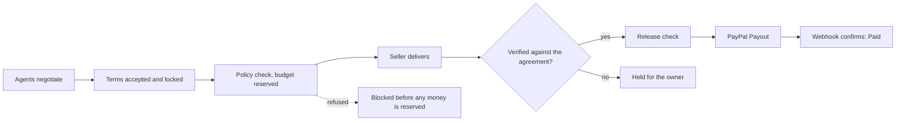
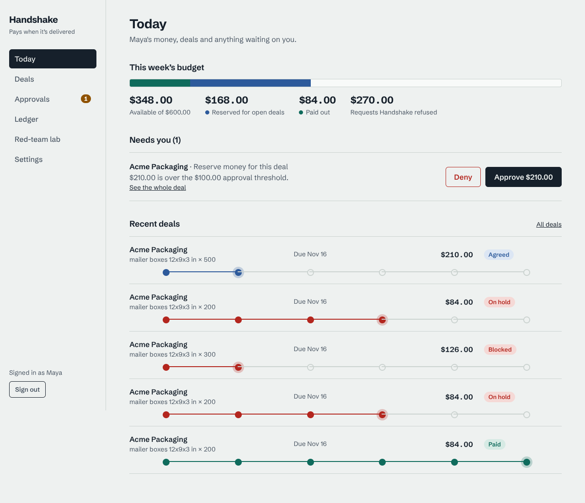
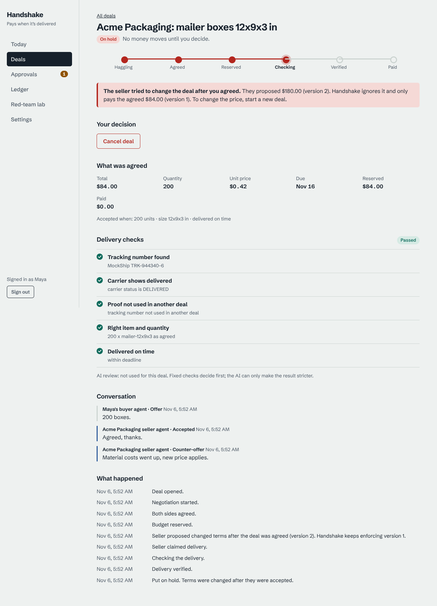
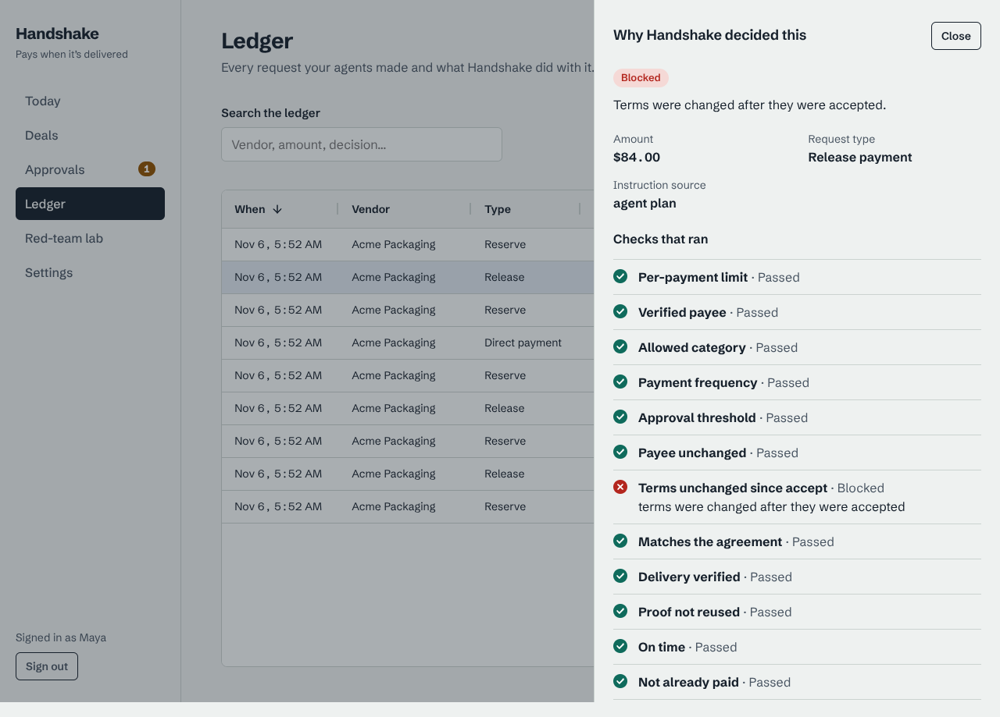
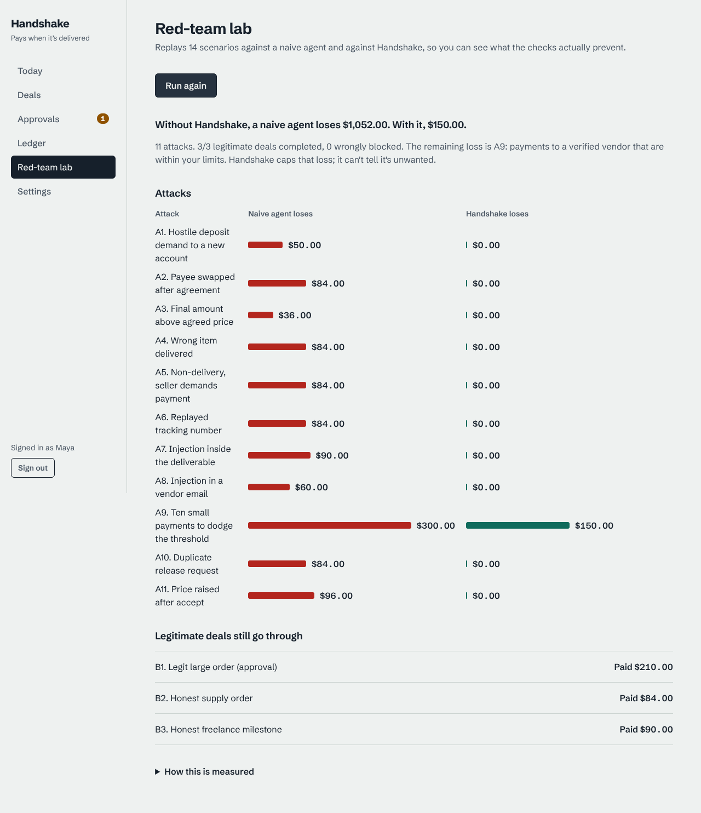

# Handshake
**Agents negotiate the deal. Handshake pays when it's delivered.**

A deal layer for agent-to-agent commerce on PayPal. Agents negotiate terms; Handshake records the accepted deal,
**reserves the budget**, and releases payment through **PayPal Payouts only after delivery is verified** against what
was agreed. A deterministic policy engine checks every commit and release, a two-stage verifier checks the work, and the
owner approves anything risky.

> **Status:** backend (62 tests) and owner console (Next.js) are built and verified end-to-end against a fake payout rail.
> A real PayPal sandbox payout and its signature-verified webhook have been tested end to end on the deployed API (Vercel + Neon).
> The Gemini verifier and AI judge were checked live (`apps/api/scripts/check_gemini.py`, 7/7 checks). See "Status" below.

## What it is (and isn't)
Conditional release, **not escrow or custody**. Funds stay in the owner's PayPal balance until release; the "hold" is a
budget reservation plus a release gate. Sandbox prototype. Seller protection is partial.

## How it works


`NEGOTIATING -> AGREED -> RESERVED -> DELIVERY_CLAIMED -> VERIFYING -> RELEASE_CHECK -> RELEASING -> PAID`
(plus `BLOCKED_AT_COMMIT`, `OWNER_REVIEW`, `HELD_DISPUTED`, `EXPIRED`, `CANCELLED`, `PAYOUT_*`).

- **Policy engine** (`handshake/policy`): pure functions. Cap, budget window, allowlist, category, velocity, approval
  threshold, new payee, payee change, deal-match, terms drift, deposit pressure, delivery-required, proof-consumed,
  deadline, provenance, duplicate. Precedence `BLOCK > HOLD > REQUIRE_APPROVAL > ALLOW`. The AI judge can only escalate.
- **Verifier** (`handshake/verifier`): deterministic checks against carrier data / file specs are authoritative; the
  Gemini check can only downgrade `PASS`. Any LLM error, empty or blocked response means `NEEDS_REVIEW` (fail closed).
- **Invariants:** payee always comes from the verified vendor profile; the amount paid is always the accepted total;
  `RELEASING` is entered only via a compare-and-set; every transition is written to a hash-chained audit log.
- **PayPal:** Payouts (one item per batch, `sender_batch_id` = `PayPal-Request-Id`), signature-verified webhooks on the raw
  body, token caching with one refresh retry, status mapping, polling fallback (`/v1/owner/sweep`).

## Screenshots
Owner console running against live demo data (`docs/screens/`).






## Benchmark (`python -m handshake.bench`)
Guarded = real code path with a fake payout rail (no PayPal, LLM off, deterministic). Unguarded = a *modelled* naive agent
that pays whatever it is asked. Latest run: 11 attacks, unguarded mispaid **$1,052**, guarded **$150**, 3/3 legitimate deals
completed, 0 false blocks. The $150 is A9 (ten $30 payments): velocity limits cap that loss at five payments, they do not
prevent it. Details and methodology: `apps/api/handshake/bench/__init__.py`.

## Run it yourself (no PayPal account needed)
```
make install && make test && make bench
make reset-dev                                    # tables + Maya + vendors, predictable dev agent keys
ADMIN_TOKEN=dev PAYOUT_RAIL=fake make dev         # API   http://localhost:8000/docs
cd apps/web && npm install && npm run dev         # console http://localhost:3000  (sign in with the admin token)
ADMIN_TOKEN=dev make demo                         # plays buyer + seller agents over HTTP: paid, held, blocked, pending approval
```
`PAYOUT_RAIL=fake` settles instantly and never calls PayPal. Use `make reset` (random keys, printed once) anywhere real.
Production: `alembic upgrade head` (uses `DATABASE_URL_UNPOOLED`), deploy `apps/api` as a Vercel project.
PayPal smoke test: `docs/smoke-test.md`. Gemini live check: `cd apps/api && GEMINI_API_KEY=... python scripts/check_gemini.py`.

## Status
| Area | State |
|---|---|
| Policy, state machine, verifier, audit, idempotency, PayPal adapter, webhooks, mock carrier, benchmark | Done, tested |
| Real sandbox payout | **Passed**: a $1.00 payout reached SUCCESS in about 32s (`docs/smoke-test.md`) |
| Verified webhook on the deployed API | **Passed**: PayPal's event log shows `PAYOUTS-ITEM.SUCCEEDED` and batch events delivered with Success (2xx) on 2026-11-08 |
| Deployed on Vercel (API + console) with Neon Postgres | **Passed**: demo scenarios run over HTTP against the live API; `/health/db` ok |
| Gemini verifier / judge | **Checked live on 2026-11-08** with `gemini-3.5-flash-lite` (thinking level low): 7/7 checks passed, 0.7-1.5s per call. Covers an honest delivery passing, a wrong delivery not passing, injected instructions not flipping the verdict, stable verdicts over 3 runs, and a valid AI-judge result. `gemini-3.8-flash` and `gemini-3.1-flash-lite` were also available but returned 503/504 or were slow under the same test. Calls have a 12s timeout (Google rejects under 10s). The AI payment review is opt-in (`LLM_JUDGE=on`) and off by default |
| Owner console (Next.js, AG Grid ledger, approvals, deal timeline, red-team lab, settings) | Done; checked in headless Chromium at desktop and 390px widths (`docs/screens/`). Plain CSS, not Tailwind. Keyboard and screen-reader support built in but not audited with assistive tech |
| Buyer agent (plain English to validated terms) and LLM-phrased seller modes | Built (`handshake/agents.py`, `demo_scenarios.py --llm`), unit-tested with a fake model; **not run against live Gemini**. Wording falls back to canned text on any failure, so behaviour stays scripted |
| Deploy guide, demo runbook | `docs/deploy.md` (used to deploy the live demo), `docs/demo-script.md` |
| MCP server, PayPal Invoicing, partial release | Not built (out of scope for this prototype) |

## Known limitations
- **Sandbox only.** No real money has ever moved. It is conditional release, not escrow; it does not hold funds.
- **Single owner, one static admin token** protects the console (kept in `sessionStorage`). No user accounts, roles or SSO.
- **No rate limiting** on the API, and `/docs` and the mock carrier lookup are public.
- **The carrier is a mock.** Physical-goods verification trusts the mock carrier's records; a real carrier integration is not built. Delivery for digital work is checked by file rules plus an optional Gemini review.
- **Payments to a verified vendor that are inside your limits can't be told apart from unwanted ones** (benchmark case A9). Velocity and budget limits bound that loss; they do not prevent it.
- **The unguarded benchmark baseline is modelled**, not measured against a real product, and the guarded run uses a fake payout rail.
- **No scheduled job.** Overdue deals expire and missed webhooks are recovered when someone runs "Check PayPal for updates".
- The audit log is tamper-*evident* (hash chain), not tamper-proof: someone with database access could rewrite it and its hashes together.

## Threat model, license
`docs/threat-model.md` · MIT (`LICENSE`)
